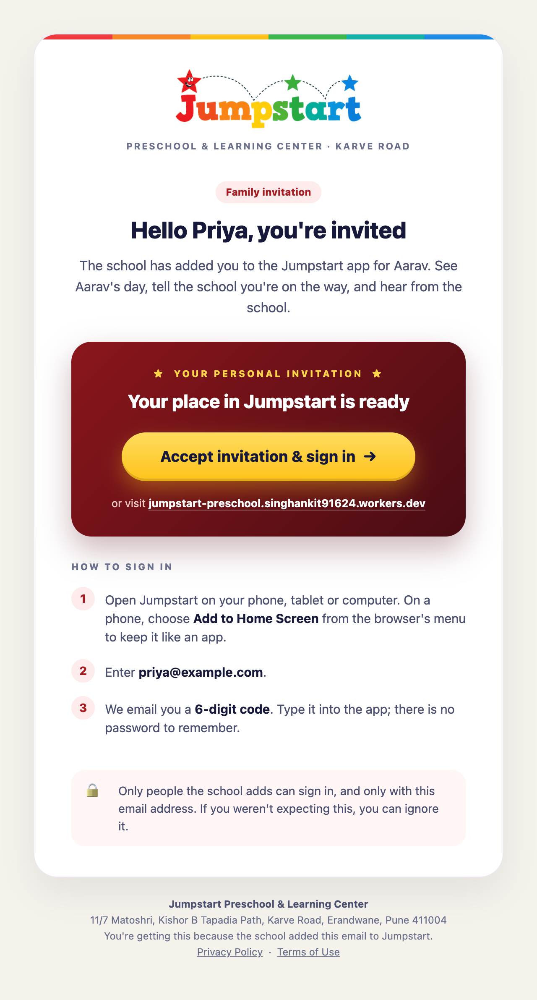

<p align="center">
  
</p>

<p align="center"><strong>Safe drop-offs and pickups for Jumpstart Preschool, Karve Road.</strong><br>
Parents say they're on the way, the gate knows who is coming, and every handover is checked and recorded.</p>

<p align="center">
  <a href="https://jumpstart-preschool.singhankit91624.workers.dev">Open the app</a> ·
  <a href="https://jumpstart-preschool.singhankit91624.workers.dev/privacy">Privacy Policy</a> ·
  <a href="docs/product/prd.md">Product decisions</a>
</p>

<p align="center">
  
</p>

## What it does

Jumpstart is an installable web app for one school. Everyone signs in with their email and a 6-digit code: no passwords, and only people the school adds can get in.

| Who | What they get |
|---|---|
| **Parents** | Today's drop-off and pickup times, "I'm on my way", changing a time, reporting an absence, and a one-time link for someone else to collect. Messages and announcements from the school. |
| **Someone collecting** (a driver, a friend) | A web page from the link, no app needed. It opens after they confirm the last 4 digits of their mobile, shows their gate code, and can share their location on the way. |
| **Gate coordinators** | A tablet queue of who is arriving and when, spoken announcements (a studio voice that says Indian names clearly, or the tablet's own), code checks and handovers. |
| **Core team** | The day's board, attendance, programme timings, each child's regular times, messages and announcements. |
| **Front desk** | Calls and walk-ins, sent to the gate at once. |
| **Admin** | Children, families and staff, classes and timings, bulk upload from Excel, invitations, settings, name pronunciation and the audit log. |

<table>
  <tr>
    <td width="33%"></td>
    <td width="33%"></td>
    <td width="33%"></td>
  </tr>
  <tr>
    <td align="center">Today, at a glance</td>
    <td align="center">On the way</td>
    <td align="center">Sending someone else</td>
  </tr>
  <tr>
    <td></td>
    <td></td>
    <td></td>
  </tr>
  <tr>
    <td align="center">The collector's link</td>
    <td align="center">On the way, sharing location</td>
    <td align="center">Only the parent sees it live</td>
  </tr>
</table>

<p align="center">
  
</p>

<table>
  <tr>
    <td width="50%"></td>
    <td width="50%"></td>
  </tr>
  <tr>
    <td align="center">The day's board</td>
    <td align="center">Schedules</td>
  </tr>
  <tr>
    <td></td>
    <td></td>
  </tr>
  <tr>
    <td align="center">Classes and timings</td>
    <td align="center">Bulk upload, checked before anything is added</td>
  </tr>
  <tr>
    <td></td>
    <td></td>
  </tr>
  <tr>
    <td align="center">A child's record</td>
    <td align="center">Invitations</td>
  </tr>
  <tr>
    <td></td>
    <td></td>
  </tr>
  <tr>
    <td align="center">Settings and name pronunciation</td>
    <td align="center">Front desk</td>
  </tr>
</table>

<p align="center">
  <br>
  <sub>The invitation email. Its button opens sign-in with the parent's email already filled in.</sub>
</p>

## Principles

- **Nothing is faked.** Times, attendance, location and notifications come from real phones and the database.
- **The database is the security boundary.** Every table uses Postgres row-level security, and every change goes through a function that checks the caller's role, validates the input and writes the audit log.
- **Location stays private.** Parents, family and staff never share or see location. Only someone collecting with a one-time link may share theirs, and only the parent who sent the link sees it.
- **Names are said properly.** Announcements keep names exactly as written on screen; the admin can set how a name is spoken.
- **Built for real phones and tablets.** Large touch targets, clear live, recent and stale states, and no page that scrolls sideways.

## Design

| | |
|---|---|
| Look | Logo red for actions, warm ivory surfaces, the smiling star, [design-system.md](docs/design/design-system.md) |
| Typeface | [Plus Jakarta Sans](https://fonts.google.com/specimen/Plus+Jakarta+Sans), self-hosted |
| Icons | [Microsoft Fluent UI Color](https://github.com/microsoft/fluentui-system-icons) (MIT, notice in `public/iconsc`), with Lucide line icons for arrows and controls |
| People | Initials on each person's colour |
| Maps | MapLibre GL with OpenFreeMap's coloured Liberty style |
| Voice | ElevenLabs studio voice (made once per announcement and cached), falling back to Kokoro on the device and then the device voice |

## Stack

| Part | What it uses |
|---|---|
| App | React 19, TypeScript, Vite, Tailwind CSS 4, React Router 7, installable through `vite-plugin-pwa` |
| Backend | Supabase: Postgres with row-level security, Auth (email codes), Realtime, Storage, Edge Functions (Deno) |
| Email | Brevo: SMTP for sign-in codes, API for invitations (`invite-send`) |
| Voice | ElevenLabs text-to-speech through the `voice-say` function; the key never reaches a browser |
| Hosting | Cloudflare Workers static assets |

Every service, its cost, free-tier limits and alternatives are in [services.md](docs/infrastructure/services.md).

## Updates on phones

The app installs to the home screen (Share → Add to Home Screen on iPhone, or Install app in Chrome). It checks for a new version when it opens, when it comes back to the screen and every 15 minutes, and updates itself when nobody is in the middle of something. A gate tablet on duty shows an Update button instead, so announcements never stop mid-duty.

## Getting started

```bash
npm install
cp .env.example .env.local   # the Supabase URL and publishable key
npm run dev
```

Migrations live in `supabase/migrations` (0001 to 0027). Apply them with:

```bash
npx supabase db push
```

Secrets for the edge functions (Brevo, ElevenLabs, the app's address) and the email templates are set up as described in [environments.md](docs/infrastructure/environments.md).

## Scripts

| Command | What it does |
|---|---|
| `npm run dev` | Starts the app against the Supabase project in `.env.local` |
| `npm run build` | Typechecks and builds for production |
| `npm test` | Runs the unit tests (Vitest) |
| `npm run test:db` | Runs the SQL tests against a throwaway local Postgres |
| `npm run deploy` | Builds and publishes to Cloudflare |
| `node scripts/email-templates.ts` | Writes the sign-in email templates in `supabase/templates` |
| `node scripts/qa/width.cjs` | Checks no page is wider than a phone, with animations running |

## Documentation

- Product: [PRD and decisions](docs/product/prd.md), [what's left](docs/planning/current-task.md)
- Architecture: [system](docs/architecture/system-architecture.md), [tracking](docs/architecture/tracking-architecture.md), [notifications](docs/architecture/notification-architecture.md)
- Infrastructure: [services](docs/infrastructure/services.md), [environments](docs/infrastructure/environments.md)
