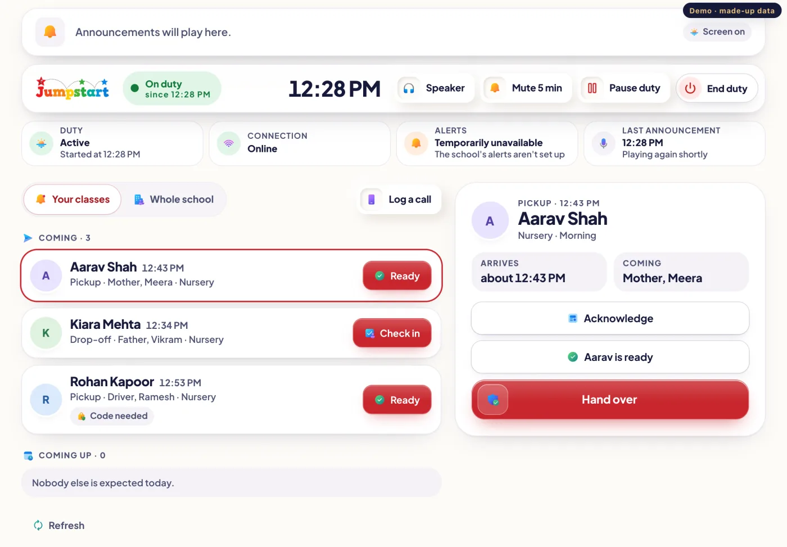
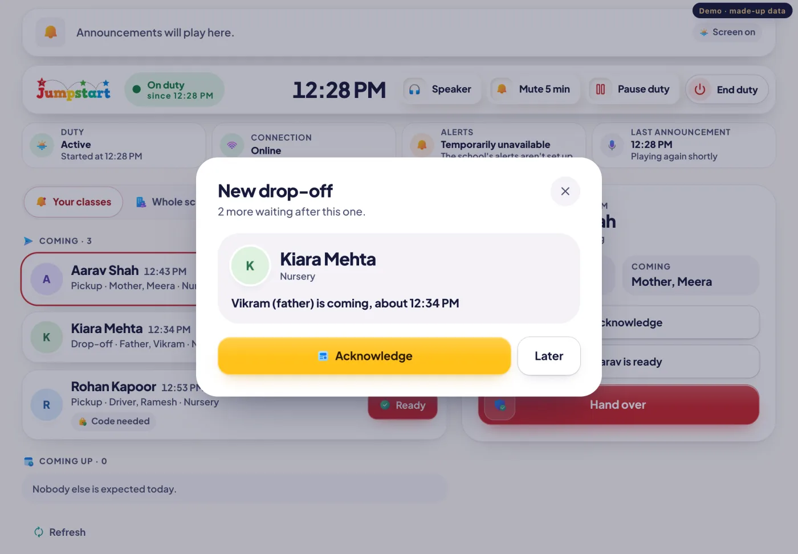
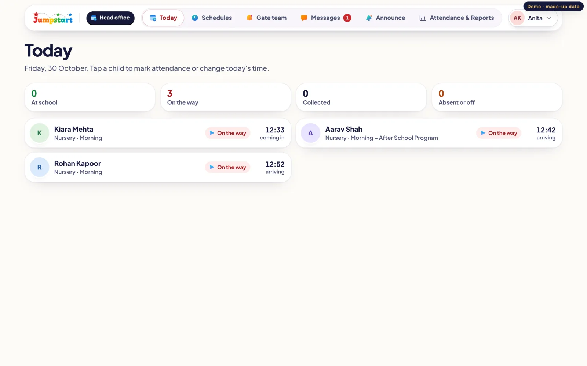
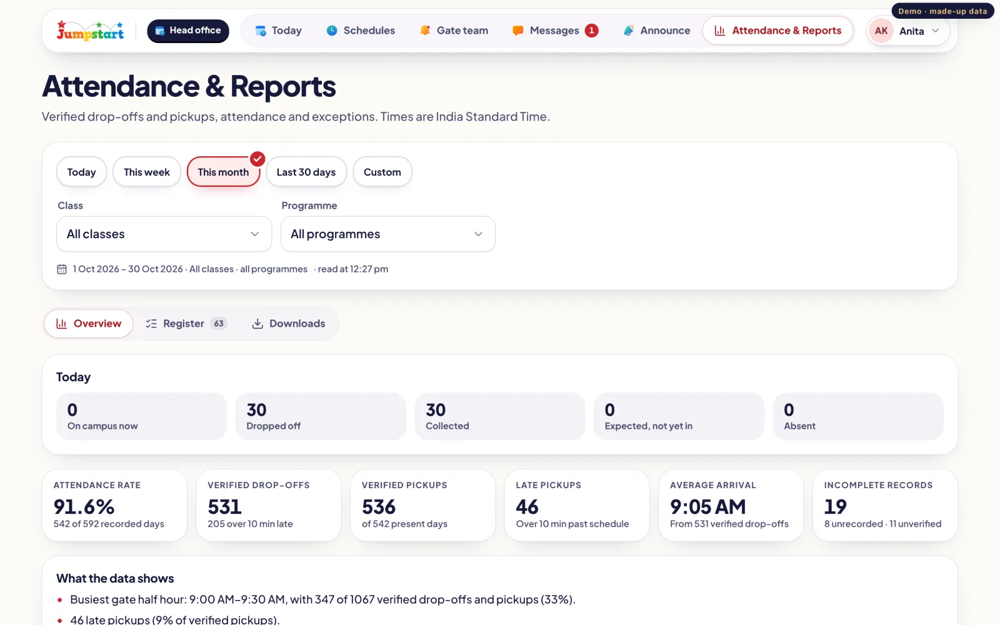
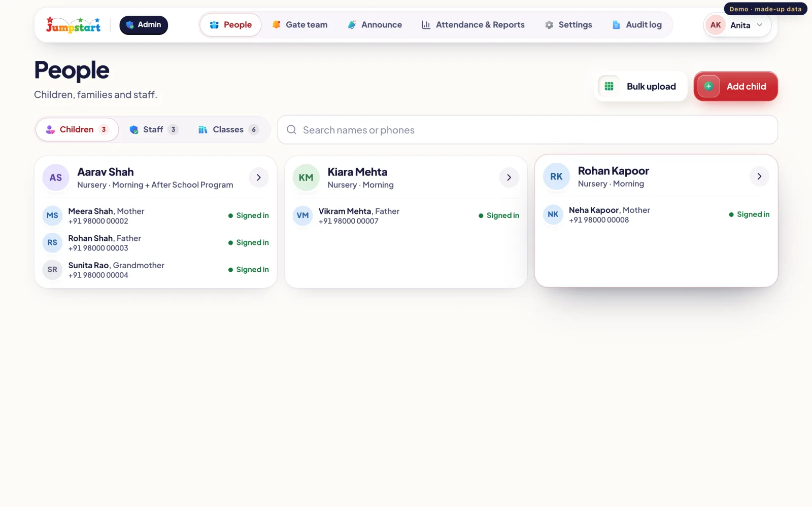
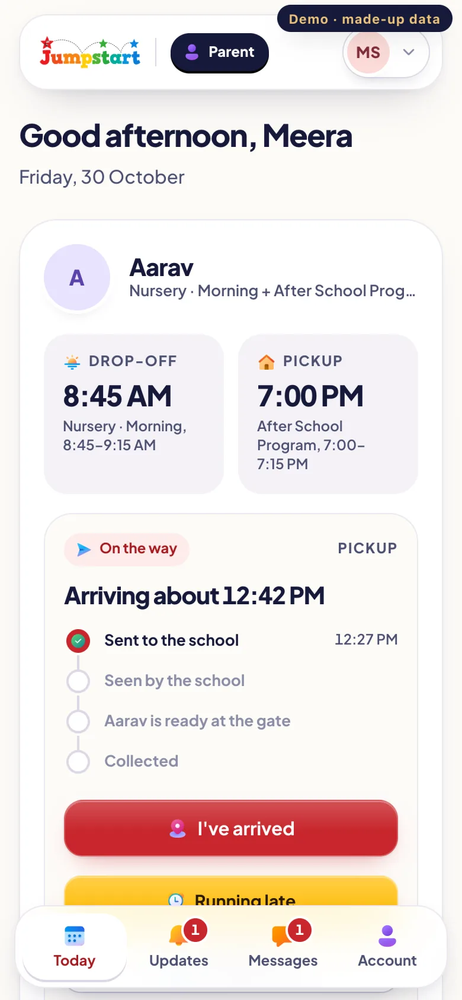
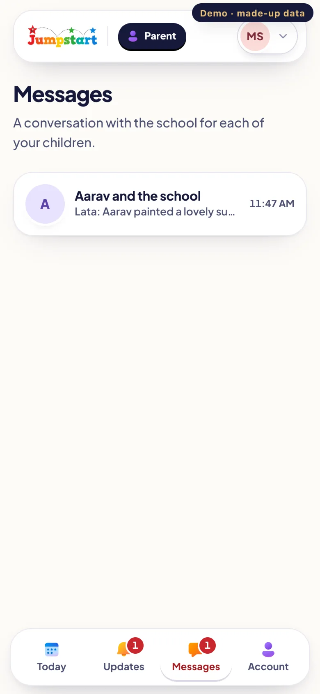
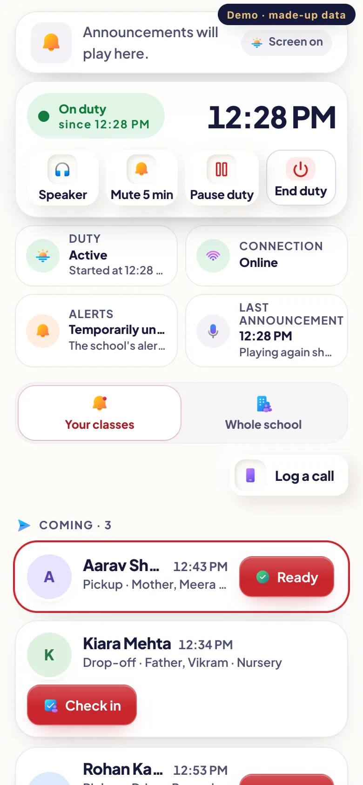
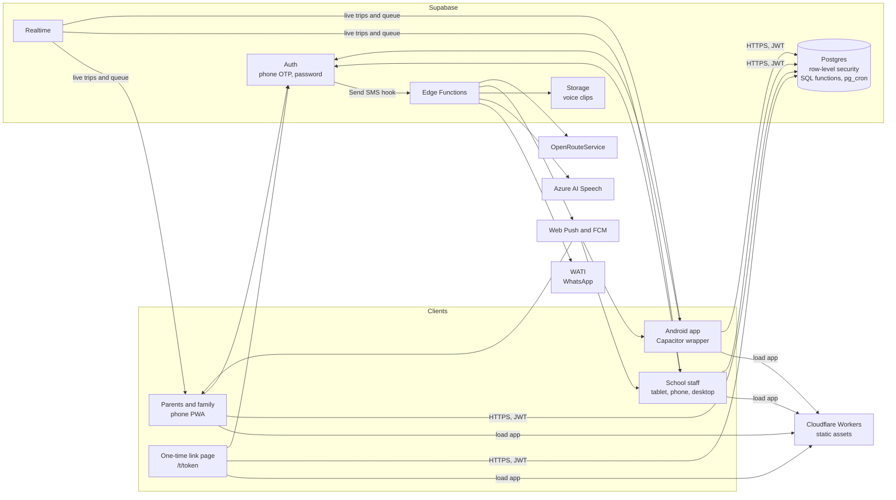
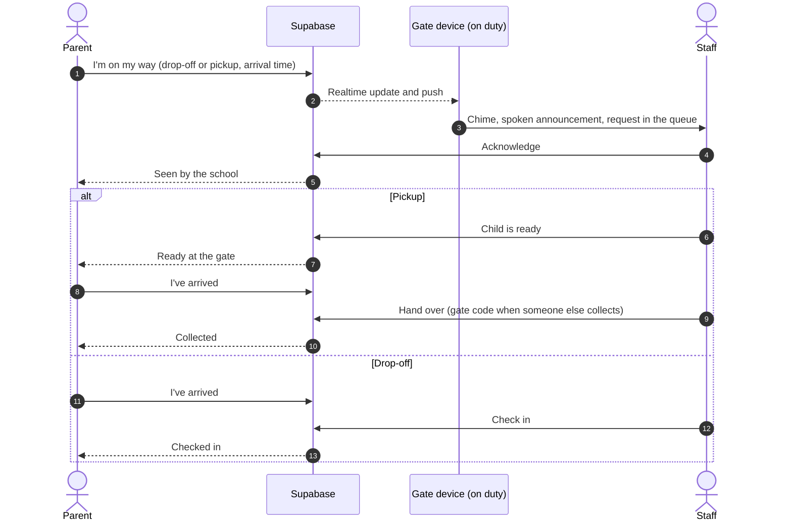

<p align="center">
  
</p>

<h1 align="center">Jumpstart Go</h1>

<p align="center">
  Smarter arrivals. Seamless coordination. Safer school operations.
</p>

<p align="center">
  
  
  
  <a href="https://github.com/JumpstartPreschool/Jumpstart-Go/actions/workflows/checks.yml"></a>
</p>

<p align="center">
  <a href="#features">Features</a> ·
  <a href="#architecture">Architecture</a> ·
  <a href="#getting-started">Getting started</a> ·
  <a href="#project-structure">Project structure</a> ·
  <a href="#testing">Testing</a> ·
  <a href="#deployment">Deployment</a> ·
  <a href="CONTRIBUTING.md">Contributing</a>
</p>

---

Pickup and drop-off at a preschool gate is a coordination problem. Parents arrive at different times, staff need to know who is coming before they reach the gate, and every child must be handed only to an approved adult.

Jumpstart Go is the platform Jumpstart Preschool uses for that. A parent taps **I'm on my way**, the gate team hears the announcement and sees the request in a live queue, the child is made ready, and the handover is checked and recorded. The school serves about 1,000 enrolled families and 300 staff (figures supplied by the school, not measured by the app).

It is an installable web app built on React and Supabase. Postgres row-level security is the enforcement point for every permission, and an optional Android wrapper keeps gate announcements playing with the screen off.

## Application showcase

All screenshots come from `npm run dev:demo`, which runs the real app against a made-up school in the browser. No real child, parent or staff data appears; the badge in the corner marks demo data.

<table>
  <tr>
    <td width="50%"></td>
    <td width="50%"></td>
  </tr>
  <tr>
    <td align="center"><sub><b>Gate queue.</b> Arrivals in order, with the next step for each child.</sub></td>
    <td align="center"><sub><b>New request.</b> Announced and shown until someone acknowledges it.</sub></td>
  </tr>
  <tr>
    <td></td>
    <td></td>
  </tr>
  <tr>
    <td align="center"><sub><b>Head office.</b> The day's board and attendance.</sub></td>
    <td align="center"><sub><b>Attendance and reports.</b> Verified records with PDF, Word and Excel exports.</sub></td>
  </tr>
  <tr>
    <td colspan="2"></td>
  </tr>
  <tr>
    <td colspan="2" align="center"><sub><b>Administration.</b> Children, families, staff and classes, with bulk upload from Excel.</sub></td>
  </tr>
</table>

<table>
  <tr>
    <td width="33%"></td>
    <td width="33%"></td>
    <td width="33%"></td>
  </tr>
  <tr>
    <td align="center"><sub><b>Parent.</b> Today, with each step of the trip.</sub></td>
    <td align="center"><sub><b>Messages</b> with the school.</sub></td>
    <td align="center"><sub><b>Gate on a phone.</b></sub></td>
  </tr>
</table>

## Features

| Feature | What it does |
|---|---|
| **Arrival requests** | A parent chooses drop-off or pickup and when they will arrive, at any time of day. Programme times are shown as a guide. They can tap **I've arrived**, report running late, change the time or cancel. |
| **Someone else collecting** | A parent can send a one-time link to a driver or relative. The link opens after the last 4 digits of their mobile are confirmed; collecting needs a 4-digit gate code. Only the parent who sent the link sees their shared location. |
| **Gate queue** | Arrivals are ordered by expected time and shown per class or for the whole school. Each request moves through Acknowledge, Ready and Hand over (pickup) or Check in (drop-off). |
| **Voice announcements** | The gate device chimes and speaks each request in an Indian English voice, with updates as the parent gets closer. Clips are made ahead of time by Azure AI Speech through the `pronounce` Edge Function; the device's own voice is the fallback. Staff approve how each name is pronounced. |
| **Duty handling** | Staff start, pause and end duty on a device. Duty state is kept on the server, so a reopened screen resumes it. Speaker, mute and screen-off controls are on the duty bar. |
| **Notifications** | Web push (VAPID) to installed apps, and FCM data messages to the Android app, which plays the school's recording with the screen off. Unread counts on Updates and Messages. |
| **Messages and announcements** | A conversation per child between family and school, plus school-wide announcements. |
| **Attendance and reports** | Daily board, attendance marking, a register, corrections and exports to PDF, Word and Excel. |
| **Administration** | Children, families, staff, classes and programmes; bulk upload from Excel with row-level checks; invitations by WhatsApp; settings; audit log. |
| **Sign-in** | Invite only. Mobile number and a 6-digit code on WhatsApp (WATI), or email and password with temporary passwords set by the school. |

**Platform limits.** The web app speaks announcements only while it is open and on screen; iOS suspends background pages. The Android wrapper (Capacitor) removes that limit on Android. The iOS notification service extension in `native-ios/` is written but has not been built or run; see [ios-app.md](docs/architecture/ios-app.md).

## Architecture



- **The database decides.** Every table has row-level security. Every state change (trip steps, attendance, schedule changes) is a SQL function that checks the caller's role, validates input, writes in one transaction and records an audit entry.
- **Secrets stay server side.** WATI, Azure, VAPID and routing keys exist only as Edge Function secrets. The browser holds only the Supabase URL and publishable key.
- **Providers are replaceable.** WhatsApp, speech and routing each sit behind an interface in `supabase/functions/_shared/`.

More detail: [system architecture](docs/architecture/system-architecture.md), [notifications](docs/architecture/notification-architecture.md), [gate voice](docs/architecture/voice-architecture.md), [tracking](docs/architecture/tracking-architecture.md), [Android app](docs/architecture/android-app.md), [attendance reports](docs/architecture/attendance-reports.md).

## Roles and workflow

| Role | Area | Responsibilities |
|---|---|---|
| **Parent and family** | `/parent` | Send drop-off and pickup requests, see each step, message the school, send a one-time link to someone else. |
| **Center coordinator** | `/coordinator` | Work the gate on duty: hear announcements, check children in, hand children over. |
| **Center leader** | `/coordinator` | Work the gate: hear requests, acknowledge them and mark children ready. |
| **Head office** | `/core` | Day board, attendance, programme timings, the gate team, messages, announcements, reports. |
| **Front desk** | `/pro` | Log calls and walk-ins straight to the gate, answer messages. |
| **Administrator** | `/admin` | Everything above plus people, roles, classes, bulk upload, settings, pronunciation and the audit log. |

A person can hold several roles and switches between areas. Roles are checked by the database on every request; hiding a button is never the only protection.



A trip is `en_route` until it ends as `handed_over` (pickup), `checked_in` (drop-off) or `cancelled`. Acknowledge, ready and arrival times are recorded on the trip. The parent can report arriving or running late at any point, and the gate announcement follows.

## Technology

| Layer | Technology | Responsibility |
|---|---|---|
| Frontend | React 19, TypeScript 7, Vite 8, React Router 7 | The app and its role areas |
| Styling | Tailwind CSS 4, design tokens, Plus Jakarta Sans | [Design system](docs/design/design-system.md) |
| PWA | `vite-plugin-pwa` (Workbox), `public/push-sw.js` | Install, app-shell caching, web push |
| Maps | MapLibre GL | Live location for one-time-link collectors |
| Reports | jsPDF, docx, ExcelJS | PDF, Word and Excel exports |
| Backend | Supabase: Postgres, Auth, Realtime, Storage, Edge Functions (Deno) | Data, permissions, live updates, server logic |
| Messaging | WATI (WhatsApp Business API) | Sign-in codes, invitations, delivery status |
| Voice | Azure AI Speech | Pre-made announcement clips |
| Android | Capacitor 8, Firebase Cloud Messaging | Screen-off announcements on Android |
| Hosting | Cloudflare Workers static assets | Serves the built app |
| Testing | Vitest, Testing Library, SQL tests on Postgres 18 | Unit, component and database tests |

Costs, free-tier limits and alternatives for each service: [services.md](docs/infrastructure/services.md).

## Getting started

**Prerequisites:** Node.js 22 (the version CI uses) and npm. For database tests, PostgreSQL 18.

```bash
git clone https://github.com/JumpstartPreschool/Jumpstart-Go.git
cd Jumpstart-Go
npm ci
```

### Try it with demo data

```bash
npm run dev:demo
```

Demo mode answers every request in the browser with a made-up school, so it needs no `.env.local` and never touches a database. Sign in with **Sign in with email and password**:

| Role | Email | Password |
|---|---|---|
| Admin and head office | `anita.kapoor@jumpstart.test` | `AdminDemo#2026` |
| Center leader | `lata.joshi@jumpstart.test` | `LeaderDemo#2026` |
| Center coordinator | `kiran.patil@jumpstart.test` | `CoordDemo#2026` |
| Parent | `meera.shah@gmail.com` | `meerQK4827#` (asks for a new one) |

These accounts exist only inside `src/lib/demo.ts`, which is excluded from production builds. The **Demo: act as a parent** panel sends trips and messages so the gate can be tried from one computer.

### Run against a Supabase project

```bash
cp .env.example .env.local   # fill in VITE_SUPABASE_URL and VITE_SUPABASE_PUBLISHABLE_KEY
npm run dev
```

Migrations are in `supabase/migrations` (`0001` to `0063`). Edge Function secrets and the auth hook setup are described in [environments.md](docs/infrastructure/environments.md). Never put a secret in a `VITE_` variable; those are bundled into the browser.

### Scripts

| Command | What it does |
|---|---|
| `npm run dev` | App against the Supabase project in `.env.local` |
| `npm run dev:demo` | App with demo data, no backend |
| `npm run typecheck` | TypeScript project check |
| `npm test` | Unit and component tests (Vitest) |
| `npm run test:db` | Applies every migration to a throwaway Postgres 18 and runs `supabase/tests` |
| `npm run build` | Typecheck and production build to `dist/` |
| `npm run check:queries` | Checks the app's queries against the live schema (needs `.env.local`) |
| `npm run deploy` | `check:queries`, build, then publish with Wrangler (maintainers only) |

## Project structure

```text
src/
  app/            routing and update prompt
  domain/         pure rules: time, programmes, lateness, freshness, contacts
  features/       one folder per area: admin, auth, duty (gate), family (parent),
                  trips, school (head office, front desk), reports, notifications
  lib/            Supabase client, realtime helpers, demo mode
  native/         bridge to the Android duty service
  ui/             design-system components
supabase/
  migrations/     numbered SQL: schema, row-level security, functions
  functions/      Edge Functions and shared modules (_shared/)
  tests/          SQL tests run by npm run test:db
android/          Capacitor Android app with the native duty and voice layer
native-ios/       iOS notification service extension (not yet built)
scripts/          query and routing checks, rollbacks, QA and demo SQL
docs/             product, architecture, design, infrastructure and security docs
public/           icons, brand assets, headers, push service worker
```

## Testing

```bash
npm run typecheck
npm test
npm run test:db
npm run build
```

Results on the handover branch (Node 22.23.2, PostgreSQL 18):

| Check | Result |
|---|---|
| `npm run typecheck` | Passes |
| `npm test` | 58 files, 502 tests passing |
| `npm run test:db` | All 63 migrations applied, 44 SQL test files passing |
| `npm run build` | Passes |
| `npm audit --omit=dev` | 0 vulnerabilities |

CI runs the same checks on every pull request ([checks.yml](.github/workflows/checks.yml)). Not covered by automated tests: the Android APK build, the iOS extension, real devices, and live WhatsApp, push and speech delivery. See [manual checks](CONTRIBUTING.md#manual-checks).

## Deployment

Production is a Cloudflare Workers static-assets site serving `dist/` as a single-page app, backed by one Supabase project. Database changes ship first, then Edge Functions, then the app:

1. Apply new migrations: `npx supabase db push --linked --dry-run`, then without `--dry-run`.
2. Deploy changed Edge Functions: `npx supabase functions deploy <name>` (flags per function in deployment.md).
3. Publish the app: `npm run deploy`.

Only maintainers with Supabase and Cloudflare access deploy. The release order, rollback scripts and checks are in [deployment.md](docs/infrastructure/deployment.md).

## Security and privacy

- Access is invite only. Every table uses row-level security, and sensitive changes are written to an audit log.
- Location is shared only by someone collecting with a one-time link, and only the parent who sent it can see it.
- Secrets live in Edge Function secrets and local `.env.local` files, which are git-ignored. `.env.example` holds placeholders only.
- Demo and test data use invented names and placeholder numbers.

Data handling is described in [data-protection.md](docs/security/data-protection.md). To report a vulnerability, follow [SECURITY.md](SECURITY.md); please do not open a public issue.

## Contributing

Branches, commits, pull requests and review: [CONTRIBUTING.md](CONTRIBUTING.md). Product decisions are recorded in the [PRD](docs/product/prd.md).

## Credits

Icons: [Microsoft Fluent UI System Icons](https://github.com/microsoft/fluentui-system-icons) (MIT, notice in `public/iconsc/LICENSE.txt`) and [Lucide](https://lucide.dev). Typeface: Plus Jakarta Sans (SIL Open Font License, `src/features/reports/fonts/OFL.txt`).
