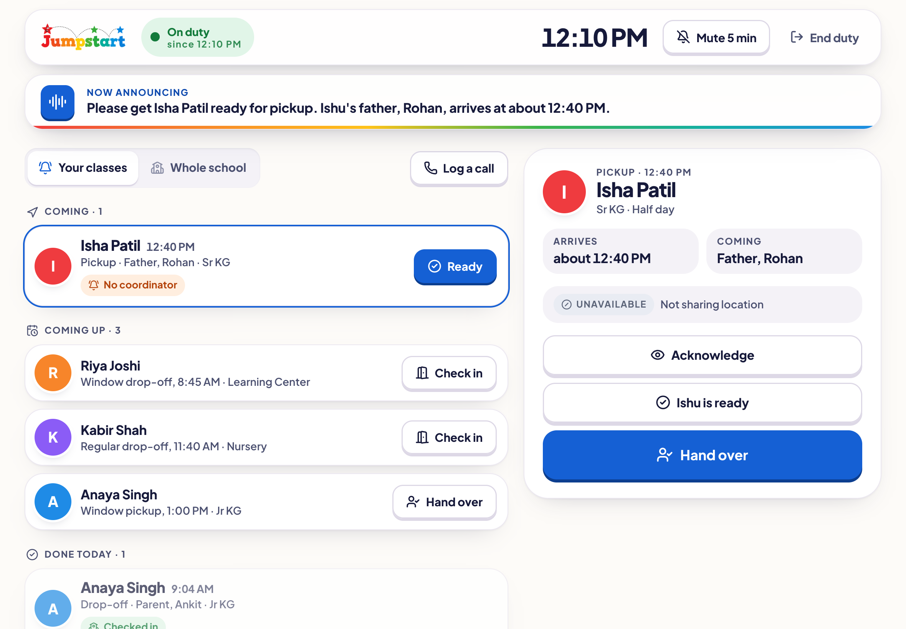
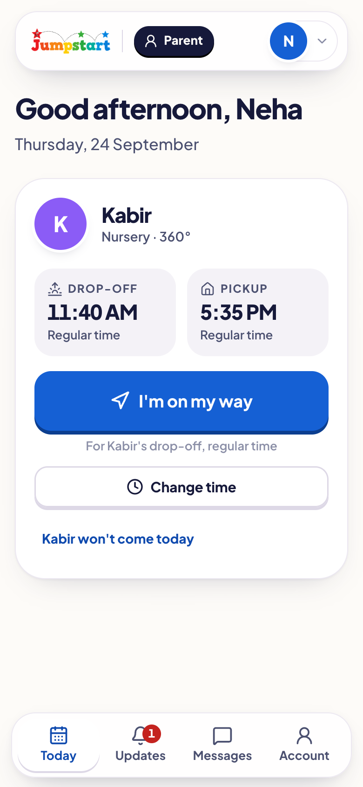
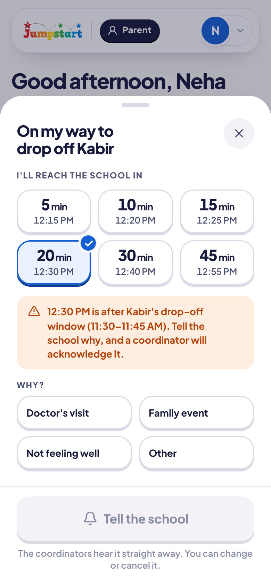
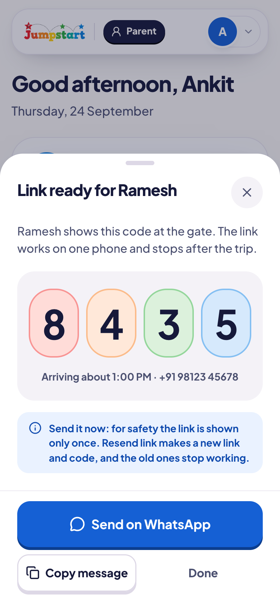
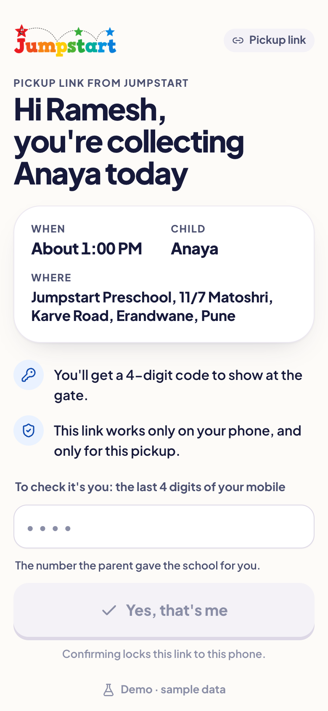
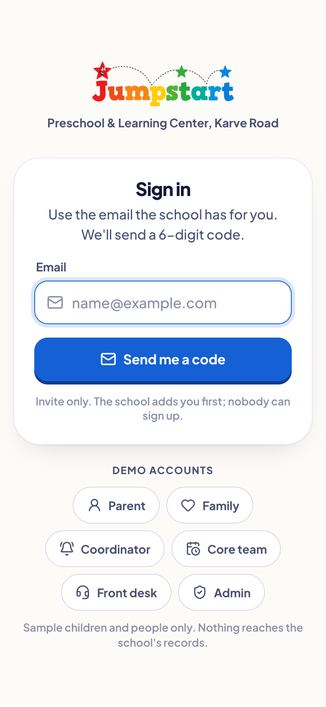
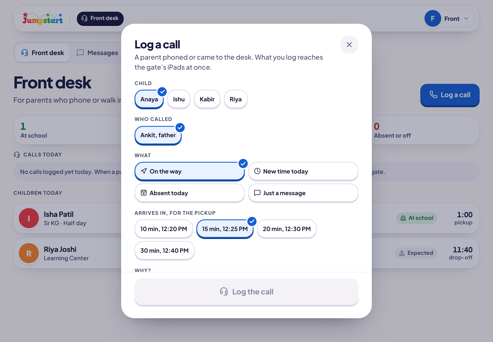
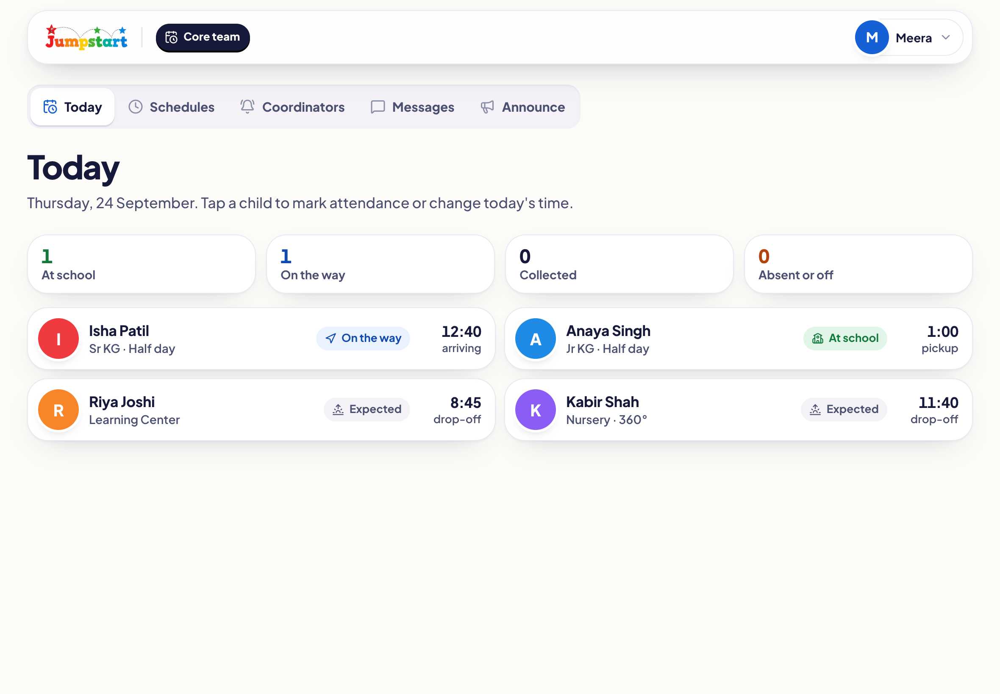
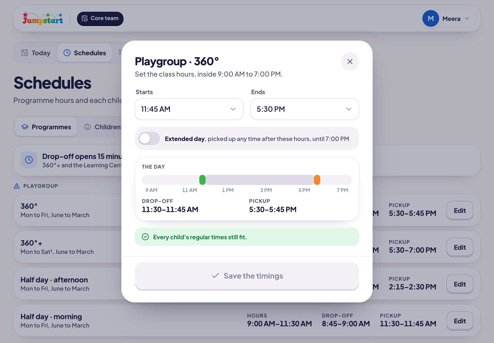
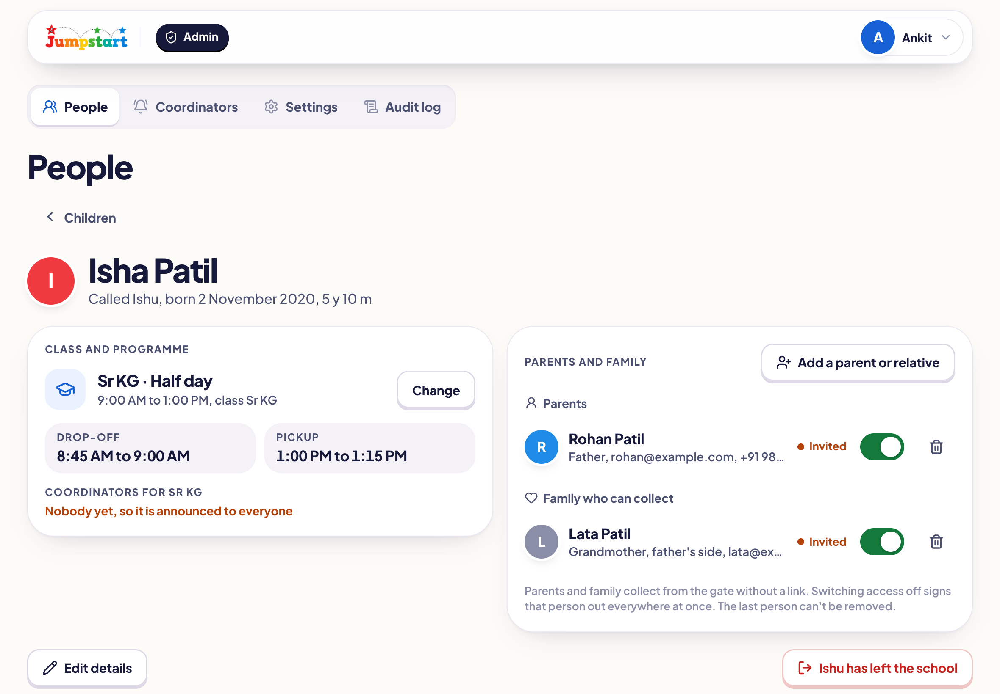

<p align="center">
  
</p>

<p align="center"><strong>Safe drop-offs and pickups for Jumpstart Preschool.</strong><br>
Parents say they're on the way, the gate knows who is coming, and every handover is checked and recorded.</p>

<p align="center">
  
</p>

## What it does

Jumpstart is an installable web app for a preschool. It has one screen for each person in the handover.

| Who | What they get |
|---|---|
| **Parents** | Today's drop-off and pickup times. An "I'm on my way" button. Changing a time or marking an absence. A one-time link and code for someone else collecting. Messages and announcements from the school. |
| **Someone collecting** (driver, grandparent) | A link that works on one phone only. It opens after they confirm the last 4 digits of their mobile number. They can share their location while travelling and show a 4-digit code at the gate. |
| **Gate coordinators** | An iPad queue of who is arriving and when. A spoken announcement in a natural voice. Code checks, walk-in check-ins and handovers to registered family. |
| **Core team** | The live board for the day. Schedules, programme hours, messages, announcements and calls to families. |
| **Front desk** | Calls and bookings for parents who phone in. |
| **Admins** | Children, families, staff roles, school settings and a readable audit log. |

<table>
  <tr>
    <td width="33%"></td>
    <td width="33%"></td>
    <td width="33%"></td>
  </tr>
  <tr>
    <td align="center">Today, at a glance</td>
    <td align="center">On the way, with location</td>
    <td align="center">Sending someone else</td>
  </tr>
  <tr>
    <td></td>
    <td></td>
    <td></td>
  </tr>
  <tr>
    <td align="center">The collector's link</td>
    <td align="center">Sign in with an email code</td>
    <td align="center">Front desk</td>
  </tr>
</table>

<p align="center">
  
</p>

<table>
  <tr>
    <td width="50%"></td>
    <td width="50%"></td>
  </tr>
  <tr>
    <td align="center">Schedules and programme hours</td>
    <td align="center">A child's record, family and access</td>
  </tr>
</table>

## Principles

- **Nothing is faked.** Location, arrival times, attendance and notifications come from real devices and the database. Development mocks exist only in the design preview, and the preview labels itself as one.
- **The database is the security boundary.** Every table uses Postgres row-level security. Every write goes through a `security definer` function that checks the caller's role, validates the input and records an audit entry.
- **Location is shared only during a trip.** Staff stop seeing a trip's points at the handover, by the server's clock.
- **Built for the gate.** The layout is tablet-first, with large touch targets and clear states: live, recent, stale and unavailable.

## Design

| | |
|---|---|
| Typeface | [Plus Jakarta Sans](https://fonts.google.com/specimen/Plus+Jakarta+Sans) (variable, self-hosted via Fontsource) |
| Source of truth | [Screen Book v3](docs/design/screen-book/v3-published.html) and the [Blueprint](docs/design/blueprint/blueprint.html) |
| System | Tokens, colours, spacing and components in [design-system.md](docs/design/design-system.md) |
| Icons | Lucide |
| Maps | MapLibre GL |
| Voice | Kokoro (open-weight TTS) runs on the device in a web worker. It uses WebGPU when available and WebAssembly otherwise, and falls back to the device voice. |

Light and dark themes, safe areas, reduced motion and reduced transparency are all supported. Glass is used only on floating layers such as the tab bar, sheets and toasts.

## Stack

- **App:** React 19, TypeScript, Vite, Tailwind CSS 4 and React Router 7, shipped as an installable web app through `vite-plugin-pwa`.
- **Backend:** Supabase with Postgres, row-level security, Realtime, Edge Functions (Deno), `pg_cron` and `pg_net`.
- **Push:** Web Push with VAPID keys. The database queues notifications and the `push-send` edge function delivers them.
- **Hosting:** Cloudflare Workers static assets.

Every service, its free-tier limits and the alternatives are listed in [services.md](docs/infrastructure/services.md).

## Getting started

```bash
npm install
cp .env.example .env.local   # fill in the Supabase URL and anon key
npm run dev
```

To try every screen without a backend, run the design preview:

```bash
VITE_DESIGN_PREVIEW=true npm run dev
```

The sign-in screen lists a demo account for each role, and the code `246810` is filled in for you. No email is sent.

### Push notifications

```bash
node scripts/vapid-keys.mjs
```

This prints a key pair. Put the public key in `.env.local` as `VITE_VAPID_PUBLIC_KEY`, and set the private key as a Supabase secret. The full steps are in [environments.md](docs/infrastructure/environments.md).

### Database

Migrations live in `supabase/migrations`. Apply them with:

```bash
npx supabase db push
```

## Scripts

| Command | What it does |
|---|---|
| `npm run dev` | Starts the dev server |
| `npm run build` | Typechecks and builds for production |
| `npm test` | Runs the unit tests (Vitest) |
| `npm run test:db` | Runs the SQL tests against a throwaway local Postgres |
| `npm run deploy` | Builds and deploys to Cloudflare |
| `npm run deploy:design` | Deploys the design preview with demo data |

The browser checks in `scripts/qa/` drive the app end to end with Playwright. `flows.cjs`, `parent.cjs`, `collector.cjs`, `trip.cjs` and `office.cjs` cover each role. `qa.cjs` checks the layout at 23 screen sizes.

## Documentation

- Product: [PRD and decisions](docs/product/prd.md), [what's left](docs/planning/current-task.md)
- Architecture: [system](docs/architecture/system-architecture.md), [tracking](docs/architecture/tracking-architecture.md), [notifications](docs/architecture/notification-architecture.md)
- Infrastructure: [services](docs/infrastructure/services.md), [environments](docs/infrastructure/environments.md)
