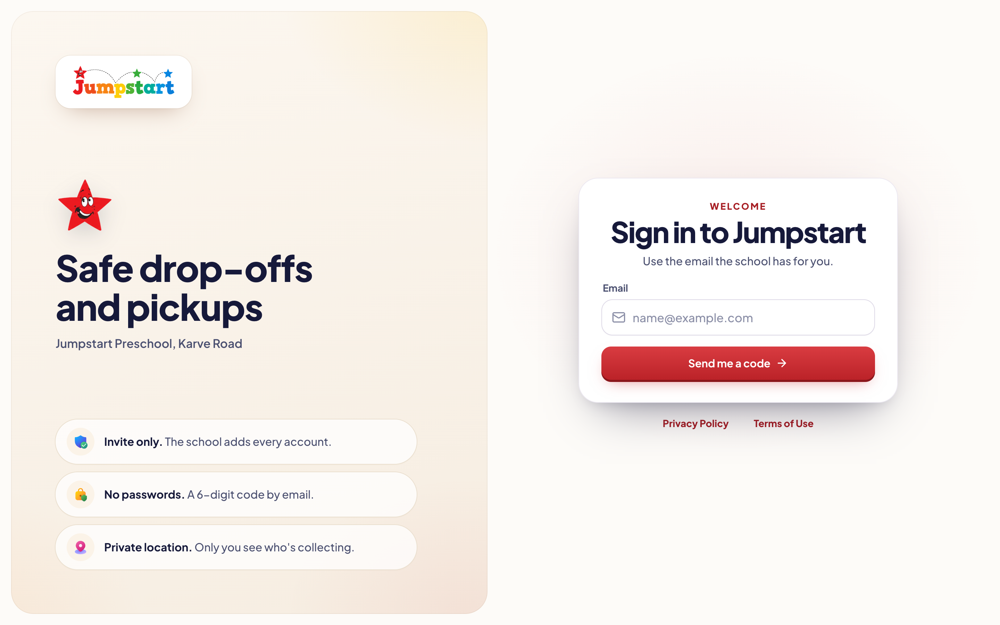
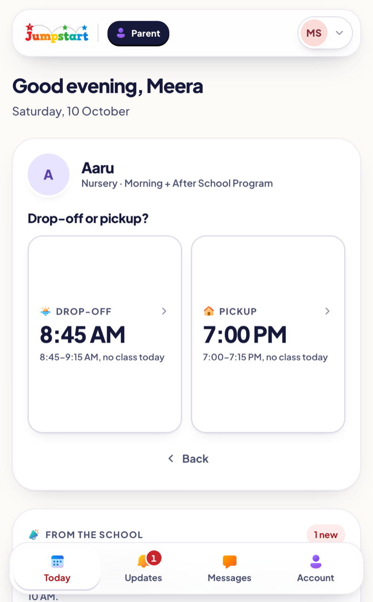
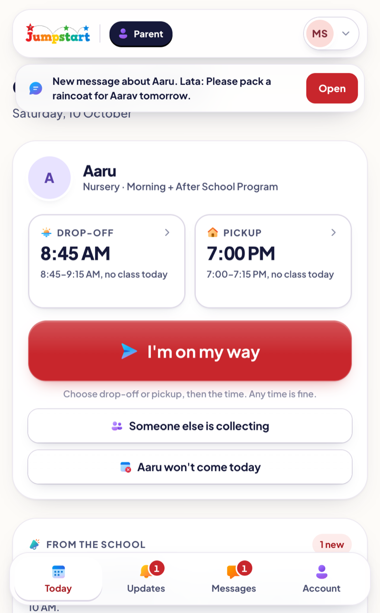
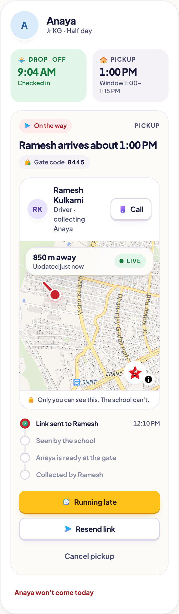
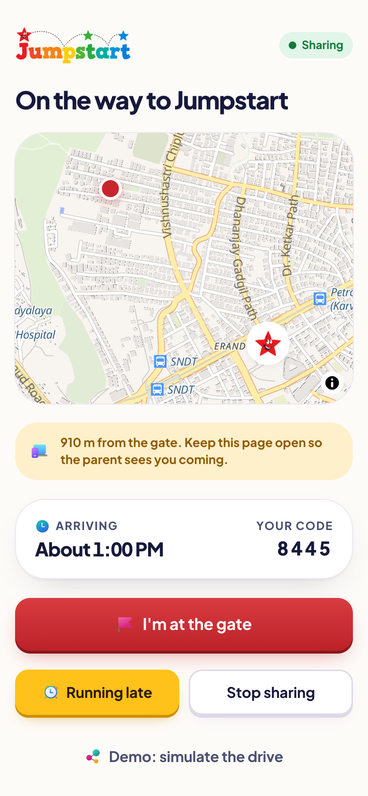
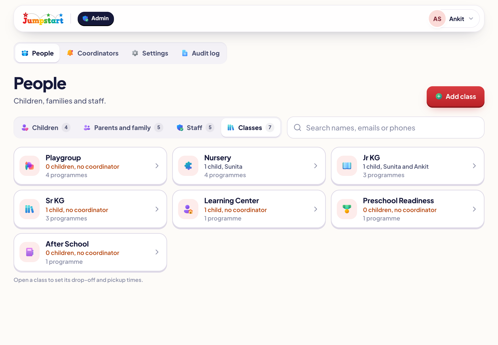
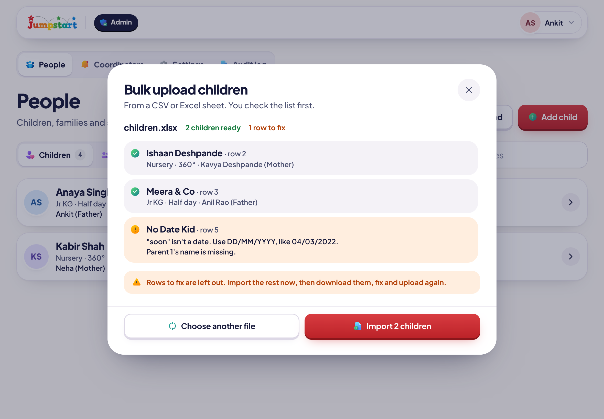
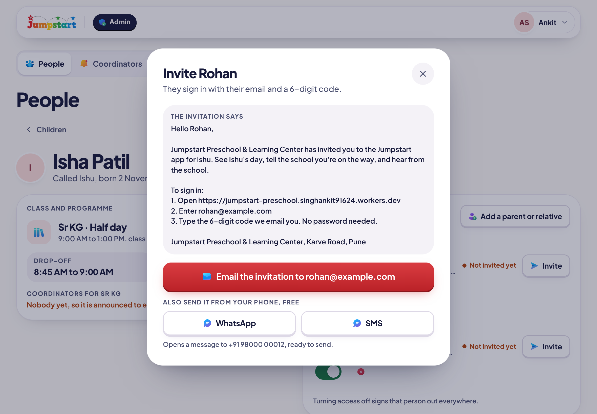
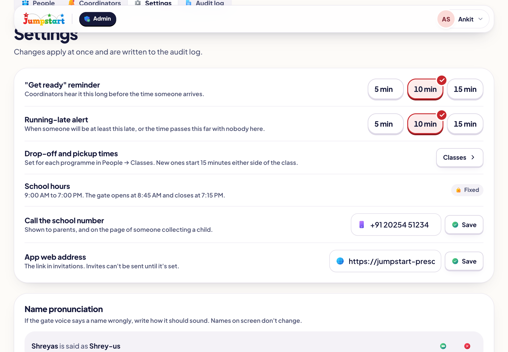

<p align="center">
  
</p>

<p align="center"><strong>Safe drop-offs and pickups for Jumpstart Preschool, Karve Road.</strong><br>
Parents say they're on the way, the gate knows who is coming, and every handover is checked and recorded.</p>

<p align="center">
  <a href="https://jumpstart-go.singhankit91624.workers.dev">Open the app</a> ·
  <a href="https://jumpstart-go.singhankit91624.workers.dev/privacy">Privacy Policy</a> ·
  <a href="docs/product/prd.md">Product decisions</a>
</p>

<p align="center">
  
</p>

## What it does

Jumpstart is an installable web app for one school. Only people the school adds can get in. They sign in with their mobile number and a 6-digit code sent on WhatsApp, and stay signed in until they tap Sign out.

| Who | What they get |
|---|---|
| **Parents** | Each child's programme times as a guide, and drop-off or pickup at any time: "I'm on my way" turns the child's card into a choice of drop-off or pickup, then the time. "I've arrived", running late, changing a time, absences for one day or several on a calendar, adding relatives, and a one-time link for someone else to drop off or collect. Messages and announcements from the school, with WhatsApp-style unread numbers and a banner when something new arrives. |
| **Someone else** (a driver, a grandparent) | A web page from the link, no app needed. It opens after they confirm the last 4 digits of their mobile, can share their location on the way, and "I'm at the gate" tells the gate they've arrived. Collecting, they show a 4-digit gate code; dropping off, the gate checks the child in. |
| **Center leaders** | A tablet queue of who is arriving and when, and spoken announcements in an Indian English woman's voice that follow the trip ("Vihaan Kulkarni's father will arrive for pickup in about ten minutes", then five, then "has arrived"), with each child's name approved by a person. A Speaker button for a Bluetooth speaker, code checks and handovers. |
| **Head office** | The day's board, attendance, programme timings, each child's regular times, and messages from families (with unread numbers and a push notification for each new one) and announcements. |
| **Front desk** | Calls and walk-ins, sent to the gate at once, and messages from families with unread numbers. |
| **Admin** | Children with their parents and family on each child's card, a main programme plus any others (After School, Learning Center), staff, center leaders, classes and timings, bulk upload from Excel (rows with missing details still go in), invitations, announcements, settings, name pronunciation and the audit log. |

<table>
  <tr>
    <td width="33%"></td>
    <td width="33%"></td>
    <td width="33%"></td>
  </tr>
  <tr>
    <td align="center">Today, with the programme's times</td>
    <td align="center">I'm on my way: drop-off or pickup?</td>
    <td align="center">Then the time</td>
  </tr>
  <tr>
    <td></td>
    <td></td>
    <td></td>
  </tr>
  <tr>
    <td align="center">A new message, with unread numbers</td>
    <td align="center">Sending someone else</td>
    <td align="center">Only the parent sees them live</td>
  </tr>
  <tr>
    <td></td>
    <td></td>
    <td></td>
  </tr>
  <tr>
    <td align="center">Their link, no app needed</td>
    <td align="center">On the way, sharing location</td>
    <td></td>
  </tr>
</table>

<p align="center">
  
</p>

<table>
  <tr>
    <td width="50%"></td>
    <td width="50%"></td>
  </tr>
  <tr>
    <td align="center">The day's board</td>
    <td align="center">Schedules</td>
  </tr>
  <tr>
    <td></td>
    <td></td>
  </tr>
  <tr>
    <td align="center">Classes and timings</td>
    <td align="center">Bulk upload, checked before anything is added</td>
  </tr>
  <tr>
    <td></td>
    <td></td>
  </tr>
  <tr>
    <td align="center">A child's record</td>
    <td align="center">Invitations</td>
  </tr>
  <tr>
    <td></td>
    <td></td>
  </tr>
  <tr>
    <td align="center">Settings and name pronunciation</td>
    <td align="center">Front desk</td>
  </tr>
</table>

## Principles

- **Nothing is faked.** Times, attendance, location and notifications come from real phones and the database.
- **Parents come when they need to.** Programme times are shown as a guide; a drop-off or pickup can be sent at any time, and the gate hears it at once.
- **Typing is forgiving.** A mobile number typed with a 0, +91 or 0091 in front, or pasted whole, is understood without asking again.
- **The database is the security boundary.** Every table uses Postgres row-level security, and every change goes through a function that checks the caller's role, validates the input and writes the audit log.
- **Location stays private.** Parents, family and staff never share or see location. Only someone collecting with a one-time link may share theirs, and only the parent who sent the link sees it.
- **Names are said properly.** Announcements keep names exactly as written on screen; the admin or head office listens to each name and can set how it's spoken.
- **Voice never slows the gate.** Every announcement is made ahead of time and kept on the tablet, so a parent's tap plays at once; if a clip isn't ready, the tablet's own voice speaks.
- **Built for real phones and tablets.** Large touch targets, the app's own date and option pickers (never the browser's), clear live, recent and stale states, and no page that scrolls sideways.

## Design

| | |
|---|---|
| Look | Logo red for actions, warm ivory surfaces, the smiling star, [design-system.md](docs/design/design-system.md) |
| Typeface | [Plus Jakarta Sans](https://fonts.google.com/specimen/Plus+Jakarta+Sans), self-hosted |
| Icons | [Microsoft Fluent UI Color](https://github.com/microsoft/fluentui-system-icons) (MIT, notice in `public/iconsc`), with Lucide line icons for arrows and controls |
| People | Initials on each person's colour |
| Maps | MapLibre GL with OpenFreeMap's coloured Liberty style |
| Voice | Microsoft Azure AI Speech (Indian English woman's voice), every child's announcements made ahead and kept, capped under the free tier; the tablet's own Indian English voice if a clip isn't ready |

## Stack

| Part | What it uses |
|---|---|
| App | React 19, TypeScript, Vite, Tailwind CSS 4, React Router 7, installable through `vite-plugin-pwa` |
| Backend | Supabase: Postgres with row-level security, Auth (mobile number and a one-time code), Realtime, Storage, Edge Functions (Deno) |
| WhatsApp | WATI: sign-in codes (through Supabase's Send SMS hook, `send-sms`) and invitations (`whatsapp-invite`); delivery status comes back through `wati-webhook` |
| Voice | Azure AI Speech behind a `TTSProvider` interface, through the `pronounce` Edge Function (the key never reaches the browser); [voice-architecture.md](docs/architecture/voice-architecture.md) |
| Hosting | Cloudflare Workers static assets |

Every service, its cost, free-tier limits and alternatives are in [services.md](docs/infrastructure/services.md).

## Updates on phones

The app installs to the home screen (Share → Add to Home Screen on iPhone, or Install app in Chrome). It checks for a new version when it opens, when it comes back to the screen and every 15 minutes, and updates itself when nobody is in the middle of something. A gate tablet on duty shows an Update button instead, so announcements never stop mid-duty.

## Getting started

```bash
npm install
cp .env.example .env.local   # the Supabase URL and publishable key
npm run dev
```

Migrations live in `supabase/migrations` (0001 to 0057). Apply them with:

```bash
npx supabase db push
```

Secrets for the edge functions (WATI: `WATI_API_TOKEN`, the template names, `SEND_SMS_HOOK_SECRET`, `WATI_WEBHOOK_SECRET`; Azure AI Speech for the gate voice: `AZURE_SPEECH_KEY`, `AZURE_SPEECH_REGION`, `AZURE_SPEECH_VOICE`; the app's address), the Phone sign-in setting and the Send SMS hook are set up as described in [environments.md](docs/infrastructure/environments.md). Keys are function secrets only, never in the app.

## Try it locally with made-up data

```bash
npm run dev:demo
```

Demo mode answers every request in the browser with a made-up school, so nothing touches the real database. Sign in with email and password:

| Who | Email | Password |
|---|---|---|
| Admin and head office | `anita.kapoor@jumpstart.test` | `AdminDemo#2026` |
| Parent | `meera.shah@gmail.com` | `meerQK4827#` (asks for a new one) |
| Center coordinator (gate) | `kiran.patil@jumpstart.test` | `CoordDemo#2026` |

The "Demo: act as a parent" panel sends messages, announcements and trips, so the badges, pop-ups and gate announcements can be tried from one computer.

## Deploying

1. Commit and push, then run the checks: `npm run typecheck`, `npm test`, `npm run test:db`, `npm run build`.
2. Apply new migrations: `npx supabase db push`.
3. Publish the app: `npm run deploy` (after `npx wrangler login`).

## Scripts

| Command | What it does |
|---|---|
| `npm run dev` | Starts the app against the Supabase project in `.env.local` |
| `npm run dev:demo` | Starts the app with made-up data, no backend needed |
| `npm run build` | Typechecks and builds for production |
| `npm test` | Runs the unit tests (Vitest) |
| `npm run test:db` | Runs the SQL tests against a throwaway local Postgres |
| `npm run deploy` | Builds and publishes to Cloudflare |
| `node scripts/qa/width.cjs` | Checks no page is wider than a phone, with animations running |
| `/scripts/qa/voice-lag/` (on `npm run dev`) | Plays real gate announcements and reports how soon the voice starts after the chime (p50, p95) |

## Documentation

- Product: [PRD and decisions](docs/product/prd.md), [what's left](docs/planning/current-task.md)
- Architecture: [system](docs/architecture/system-architecture.md), [tracking](docs/architecture/tracking-architecture.md), [notifications](docs/architecture/notification-architecture.md), [gate voice](docs/architecture/voice-architecture.md)
- Security: [data protection](docs/security/data-protection.md)
- Infrastructure: [services](docs/infrastructure/services.md), [environments](docs/infrastructure/environments.md)
